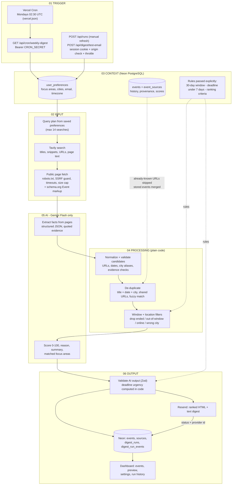
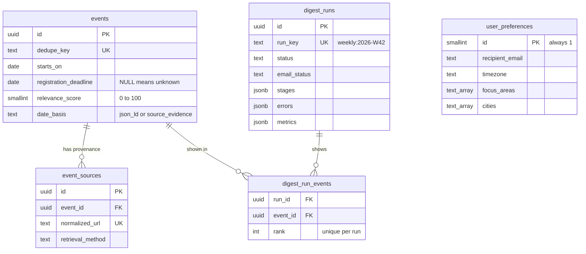

# Components Map: as implemented

The course structure is **TRIGGER → INPUT → CONTEXT → PROCESSING → AI → OUTPUT**
(`industry_event_scout_components_map.jpg`). This page documents the system **as built**; the stage names below are the
literal stage names the pipeline records in `digest_runs.stages` and shows in the dashboard's *Runs & metrics* tab.

> The map lists CONTEXT as step 3 (what the system needs to interpret the inputs). In the running pipeline the context is
> loaded first - the preferences define the queries - and its values (window, deadline rule, ranking criteria) are then passed *explicitly* into the
> later stages, exactly as the map describes.

## Stage-by-stage (code ↔ map)

| Map step | Recorded stage name | What it does | Code |
| --- | --- | --- | --- |
| **01 TRIGGER** | `cron trigger` / `manual trigger` | Vercel Cron calls the weekly endpoint (UTC schedule `30 2 * * 1` = Monday 08:00 IST, best effort). A protected manual run and a protected test-email action exist for development. The endpoint rejects anything without the exact `CRON_SECRET`; manual routes need the signed session; each is idempotent / throttled. | `vercel.json`, `src/app/api/cron/weekly-digest/route.ts`, `src/app/api/runs/route.ts`, `src/lib/auth/guard.ts`, `src/lib/db/runs.ts` (`claimRun`, `claimThrottledRun`) |
| **02 INPUT** | `search (Tavily)` | Bounded queries built from the saved focus areas × cities, plus iSPIRT and event-platform queries. Titles, snippets, URLs and extracted page text come back from Tavily. Failures are counted per query; auth/quota errors stop the rest. | `src/lib/input/queries.ts`, `src/lib/input/tavily.ts` |
| | `retrieve public event pages` | Fetches accessible public pages (schema.org `Event` JSON-LD + text). Respects robots.txt, never fetches login-walled platforms, blocks private addresses, 8 s / 1.5 MB limits. Falls back to Tavily's page text, then the snippet. Unpublished facts stay unknown. | `src/lib/input/pageFetch.ts`, `html.ts`, `jsonld.ts`, `src/lib/pipeline/retrieval.ts` |
| **03 CONTEXT** | `load preferences and stored events` | One round trip each for preferences, stored in-window events (with all sources) and recently seen source URLs. Computes the 30-day window in the user's timezone. | `src/lib/db/preferences.ts`, `events.ts`, `src/lib/dates/window.ts`, `src/lib/config.ts` |
| **04 PROCESSING** | `normalize and validate candidates` | Merges schema.org data with evidence-checked AI output into source-grounded records; unverifiable dates drop the event, unverifiable venue / city / deadline become *unknown*. | `src/lib/processing/candidates.ts`, `evidence.ts`, `normalize.ts`, `urls.ts` |
| | `deduplicate and apply filters` | Merges repeats (identity = normalized title + date + city, shared URLs, fuzzy match) while preserving every source; removes ended / out-of-window events; applies location and online filters when the data supports them. | `src/lib/processing/dedupe.ts`, `filters.ts` |
| **05 AI / GEMINI FLASH** | `extract event facts (Gemini)` | Batched structured extraction (`responseJsonSchema`), each fact accompanied by a verbatim quote that code then verifies. Page text is untrusted data. | `src/lib/ai/extract.ts`, `prompts.ts`, `schemas.ts`, `llm.ts` |
| | `rank relevance (Gemini)` | Score (integer 0-100), one-line rationale, short factual summary, matched focus areas. Per-item Zod validation, retries only the missing ids, discards uniform scores, never clamps. | `src/lib/ai/rank.ts` |
| **06 OUTPUT** | `persist events and digest` | Validates the final records, **calculates deadline urgency in code**, builds the ranked digest, and stores events, sources and the ordered run list in Neon in a single transaction. | `src/lib/output/digest.ts`, `src/lib/dates/deadlines.ts`, `src/lib/db/events.ts` |
| | `send digest (Resend)` | Renders a responsive HTML + plain-text email and submits it with a Resend idempotency key. `email_status = sent` is written only after Resend accepts the message. | `src/lib/output/email.ts`, `mailer.ts`, `src/lib/pipeline/run.ts` |
| | Dashboard | Review events (sort/filter), deadline states, settings, digest preview, manual refresh, run history with stage errors. | `src/app/dashboard/page.tsx`, `src/components/dashboard/*` |

## Run outcome rules

| Situation | Run status | Email |
| --- | --- | --- |
| Everything ok, email accepted by Resend | `succeeded` | `sent` |
| Email accepted, but a stage degraded (some searches failed, some events unranked, Gemini down...) | `partial` | `sent`, with the problem listed |
| Email not sent for any reason (Resend error, no recipient, DB write failed) | `failed` | `failed` / `skipped` (error stored) |
| A `failed`/`partial` weekly run whose email was **not** sent, retried the same ISO week | taken over, `attempt + 1` | sent once |
| Same week, email already sent (duplicate cron delivery, manual retry) | untouched | **never sent twice** |

## Data model (Neon)

Schema: [`db/migrations/001_init.sql`](../db/migrations/001_init.sql), applied by `npm run db:setup`.

## What was deliberately left out (scope cuts)

No map or calendar integration, no auto-registration, no second AI provider, no paid scraping, no link-click tracking, no user accounts beyond the single protected dashboard.
